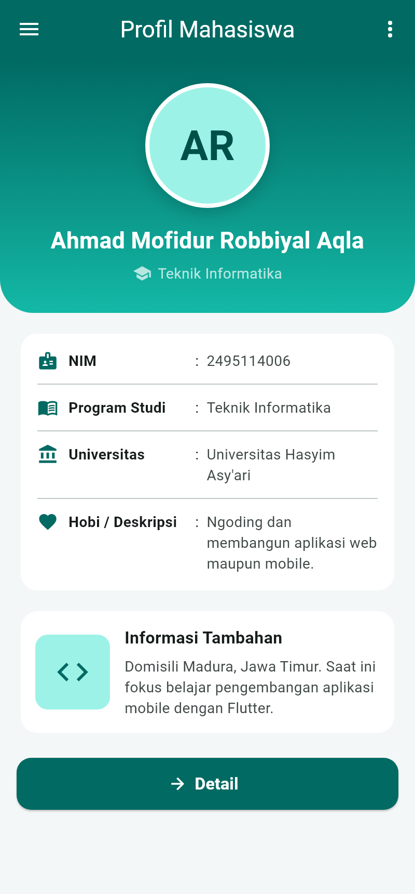
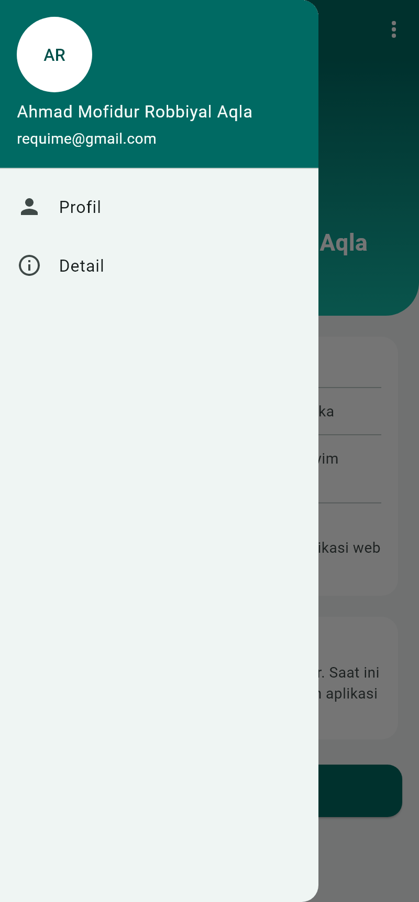
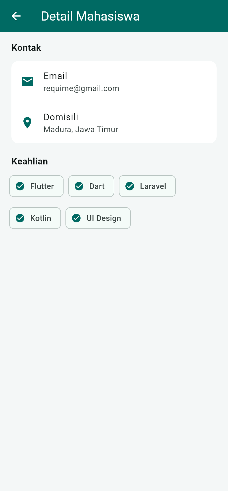

# Profil Mahasiswa

Aplikasi Flutter sederhana bertema **Profil Mahasiswa** untuk tugas mandiri
**LKP Widget dan Layout pada Flutter** (mata kuliah Pemrograman Mobile).

| | |
|---|---|
| Nama | Ahmad Mofidur Robbiyal Aqla |
| NIM | 2495114006 |
| Program Studi | Teknik Informatika |
| Universitas | Universitas Hasyim Asy'ari |
| Pertemuan | Sesi 7 |

## Tampilan

| Halaman Profil | Menu Samping | Halaman Detail |
|---|---|---|
|  |  |  |

Desain mengikuti wireframe tugas ([screenshots/wireframe.png](screenshots/wireframe.png)):
AppBar dengan menu, foto profil bulat, nama mahasiswa, kartu identitas
(NIM, Program Studi, Universitas, Hobi), kartu Informasi Tambahan, dan tombol Detail.

## Widget yang digunakan

| Widget | Kegunaan di aplikasi |
|---|---|
| `Scaffold`, `AppBar` | Kerangka halaman dan bilah judul "Profil Mahasiswa" |
| `Drawer`, `PopupMenuButton` | Menu garis tiga (kiri) dan menu titik tiga (kanan) di AppBar |
| `Column` | Menyusun header, kartu identitas, kartu tambahan, dan tombol secara vertikal |
| `Row` | Menyusun label, titik dua, dan nilai identitas secara horizontal; gambar + teks pada Informasi Tambahan |
| `Container` | Header bergradasi dengan sudut bawah membulat, bingkai foto profil, kotak gambar |
| `CircleAvatar` | Foto profil berisi inisial nama |
| `Card`, `Divider` | Kartu identitas dan kartu informasi tambahan |
| `Icon` | Ikon pada setiap baris identitas, kontak, dan keahlian |
| `ElevatedButton` | Tombol "Detail" untuk membuka halaman detail |
| `ListView`, `ListTile` | Isi drawer dan daftar kontak di halaman detail |
| `Wrap`, `Chip` | Daftar keahlian di halaman detail |
| `SingleChildScrollView`, `Padding`, `SizedBox`, `Expanded` | Menggulir halaman serta mengatur jarak dan lebar |

## Struktur kode

```
lib/
├── main.dart                 # Entry point & tema (teal, Material 3)
├── data/mahasiswa.dart       # Model + data profil (ubah di sini)
├── pages/
│   ├── profil_page.dart      # Halaman utama sesuai wireframe
│   └── detail_page.dart      # Halaman detail (kontak & keahlian)
└── widgets/
    ├── profile_header.dart   # Header: foto profil, nama, prodi
    └── info_row.dart         # Satu baris identitas (Row)
```

## Menjalankan

```bash
flutter pub get
flutter run -d chrome
flutter test
```
# mobile_programing
